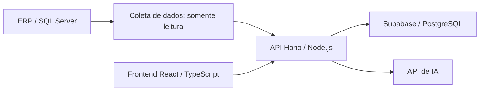

# Abastece Pro

**Status:** em produção.
**Tipo:** Plataforma operacional integrada a ERP.

## Escopo

Plataforma para lojas de conveniência, com leitura de dados do ERP, indicadores operacionais, jornada de compras e recursos de IA.

- Dashboards e apoio à decisão sobre a operação.
- Integração com o ERP e tratamento dos dados na camada de serviços.
- Recursos de IA associados aos fluxos do produto.

## Stack

React, TypeScript, Hono/Node.js, Supabase/PostgreSQL, SQL Server, Claude e Cloudflare.

## Visão de arquitetura

Diagrama de alto nível das principais camadas e integrações.

## Pontos de engenharia

- Leitura do ERP separada da interface web.
- Camada de API entre a aplicação, os dados operacionais e as integrações.
- Integração de modelos de IA com informações e regras do domínio.

## Conheça

[Aplicação](https://abastece-pro-br.com.br) · [Apresentação](https://luisbraghin.com.br/br?p=abastecepro)

O código da aplicação permanece em repositórios privados. Este estudo apresenta o escopo técnico e os pontos de arquitetura do produto.
