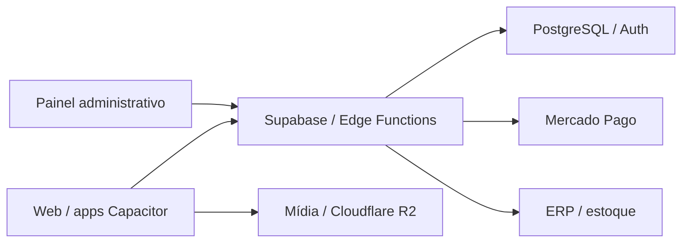

# Acelera Racing

**Status:** em produção.
**Tipo:** E-commerce, operação e aplicativos iOS/Android.

## Escopo

Plataforma que integra loja, agendamentos, escola de pilotagem, eventos e comunidade ao site, aos aplicativos e à gestão do negócio.

- Aplicativos iOS e Android, site e e-commerce.
- Agendamentos, eventos e recursos da comunidade.
- Painel administrativo e integrações com a operação.

## Stack

React, TypeScript, Capacitor, Supabase, Mercado Pago, Bling, Cloudflare e R2.

## Visão de arquitetura

Diagrama de alto nível das principais camadas e integrações.

## Pontos de engenharia

- Reuso da aplicação entre web e mobile.
- Integração com pagamentos, ERP/estoque e armazenamento de mídia.
- Tratamento de autenticação, webhooks e fluxos administrativos.

## Conheça

[Site](https://aceleraracing.com) · [App Store](https://apps.apple.com/br/app/acelera-racing/id6770384289) · [Google Play](https://play.google.com/store/apps/details?id=com.aceleraracing.app)

O código da aplicação permanece em repositórios privados. Este estudo apresenta o escopo técnico e os pontos de arquitetura do produto.
