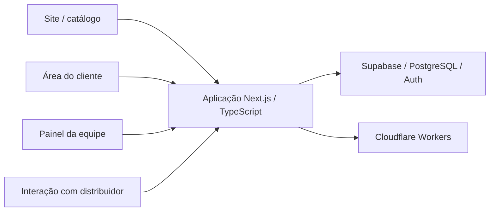

# CRIT-IX Networks

**Status:** em produção.
**Tipo:** Plataforma B2B e operação comercial.

**Contexto:** projeto contratado pela CRIT-IX Networks para apoiar sua operação comercial.

## Contratação e uso operacional

A CRIT-IX Networks é uma empresa de soluções de rede e infraestrutura que me contratou para desenvolver sua plataforma. O sistema conecta a presença pública da empresa à rotina comercial da equipe e ao relacionamento com clientes e distribuidores.

O trabalho reúne site, catálogo, área do cliente, painel interno e interação com distribuidores, acompanhando o fluxo de uma demanda até a elaboração de propostas comerciais.

## Escopo

Aplicação que conecta catálogo técnico, pedidos de cotação, distribuidores, propostas e relacionamento comercial, com superfícies para clientes e equipe.

- Site e catálogo técnico.
- Fluxos de cotação e propostas comerciais.
- Área do cliente, painel interno e interação com distribuidores.

## Stack

Next.js, TypeScript, Supabase/PostgreSQL, Cloudflare Workers e OpenNext.

## Visão de arquitetura

Diagrama de alto nível das principais camadas e integrações.

## Pontos de engenharia

- Organização de diferentes perfis e superfícies no mesmo produto.
- Modelagem dos fluxos de cotação e proposta.
- Integração entre aplicação Next.js, autenticação e serviços de backend.

## Conheça

[Site](https://crit-ix.com) · [Apresentação](https://luisbraghin.com.br/br?p=critical-power)

O código da aplicação permanece em repositórios privados. Este estudo apresenta o escopo técnico e os pontos de arquitetura do produto.
