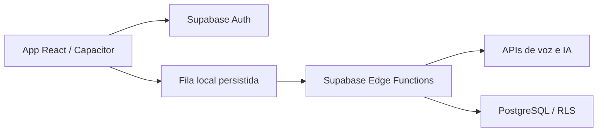

# FalaFit

**Status:** em produção.
**Tipo:** produto próprio — aplicativo mobile iOS/Android com voz e IA.

## Escopo

Aplicativo de registro alimentar por voz: o usuário fala ou escreve o que comeu e recebe um registro da refeição com estimativas de calorias e macronutrientes. O histórico permite acompanhar a rotina alimentar.

- Entrada de refeições por áudio ou texto.
- Processamento por APIs de IA e registro estruturado da refeição.
- Histórico e persistência dos dados do usuário.
- Fluxo offline-first com fila de mensagens persistida.

## Stack

React, TypeScript, Capacitor, Supabase, PostgreSQL, Edge Functions e APIs da OpenAI e Anthropic/Claude.

## Visão de arquitetura

Diagrama de alto nível das camadas descritas na apresentação pública do aplicativo.

## Pontos de engenharia

- Integração de voz, interpretação e persistência em um fluxo de uso no celular.
- Processamento de IA na camada de serviços.
- Fila persistida para o fluxo offline-first.
- Controle de acesso aos registros e persistência atômica no banco.

## Conheça

[Site](https://falafit.com.br) · [App Store](https://apps.apple.com/br/app/falafit/id6760046289) · [Google Play](https://play.google.com/store/apps/details?id=br.com.falafit.app)

O código da aplicação permanece em repositórios privados. Este estudo apresenta o escopo técnico e os pontos de arquitetura do produto.
