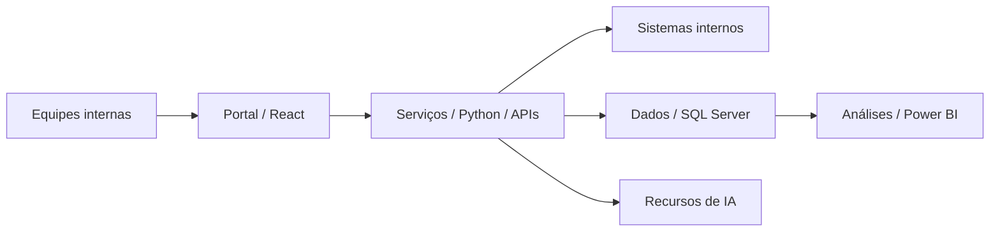

# Portal de Planejamento · Travelex

**Contexto:** plataforma interna desenvolvida na minha atuação no Travelex.
**Tipo:** sistema corporativo para processos e inteligência comercial.

## Uso operacional

O Portal de Planejamento reúne CRM, fluxos de contratos e solicitações de pagamento, atendimento e inteligência comercial. A plataforma integra sistemas do banco e recursos de IA para apoiar a rotina das equipes.

O projeto faz parte da minha atuação no Travelex e atende processos internos da operação comercial.

## Escopo

- Centralização de informações e relacionamento comercial.
- Fluxos de contratos, solicitações de pagamento e atendimento.
- Integração de sistemas, dados e recursos de IA.
- Painéis e informações para apoiar a gestão comercial.

## Stack

React, Python, SQL Server, Power BI, APIs e IA aplicada.

## Visão de arquitetura

Diagrama de alto nível das camadas descritas na apresentação pública do projeto.

## Pontos de engenharia

- Integração de uma interface comum a diferentes processos internos.
- Modelagem dos fluxos e do acesso às informações.
- Conexão entre serviços, dados, análises e recursos de IA.

## Conheça

[Apresentação pública](https://luisbraghin.com.br/br?p=travelex-portal)

Este estudo apresenta o escopo já divulgado no portfólio. O sistema e seu código são internos; o acesso público é à apresentação do projeto.
