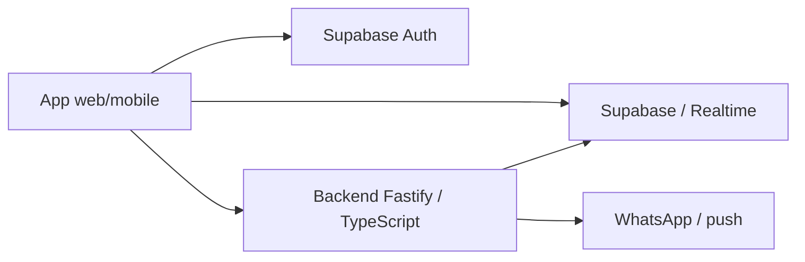

# PortariaGo

**Status:** em produção.
**Tipo:** Aplicativo mobile e backend para condomínios.

## Escopo

Aplicativo para comunicação entre portaria e moradores, avisos de entrega, confirmação de retirada e histórico de notificações.

- Aplicativo para moradores e operação da portaria.
- Backend responsável por integrar os avisos aos canais de notificação.
- Autenticação, histórico e consulta das entregas.

## Stack

React, TypeScript, Capacitor, Fastify, Supabase/PostgreSQL, Realtime, WhatsApp e FCM.

## Visão de arquitetura

Diagrama de alto nível das principais camadas e integrações.

## Pontos de engenharia

- Separação entre experiência mobile, dados e serviço de notificações.
- Integração do aplicativo com APIs e eventos de comunicação.
- Tratamento do resultado do envio no backend.

## Conheça

[App Store](https://apps.apple.com/br/app/portaria-go/id6759523269) · [Apresentação](https://luisbraghin.com.br/projetos/portariago/)

O código da aplicação permanece em repositórios privados. Este estudo apresenta o escopo técnico e os pontos de arquitetura do produto.
