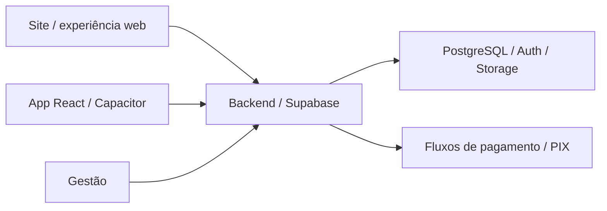

# Ronron Cat Café

**Status:** em produção.
**Tipo:** Site, aplicativos iOS/Android e gestão.

**Contexto:** projeto contratado pelo Ronron Cat Café para apoiar a operação da empresa.

## Contratação e uso operacional

O Ronron Cat Café é uma empresa de cafeteria e experiências com gatos que me contratou para desenvolver sua plataforma. O trabalho conecta os canais digitais usados pelos clientes ao painel utilizado pela equipe na gestão diária do café.

A plataforma atende diferentes partes da operação: apresentação do negócio, reservas e experiências, relacionamento com os clientes e acompanhamento administrativo. Site, aplicativos e gestão fazem parte da mesma entrega.

## Escopo

Site e aplicativos para reservas, experiências, oficinas, adoção de gatos e relacionamento com os clientes, integrados à gestão do café.

- Aplicativos iOS e Android integrados à operação.
- Reservas, experiências e recursos de relacionamento com clientes.
- Painel administrativo e fluxos de gestão.

## Stack

React, TypeScript, Capacitor, Supabase, Edge Functions e PIX.

## Visão de arquitetura

Diagrama de alto nível das principais camadas e integrações.

## Pontos de engenharia

- Integração entre superfícies web/mobile e backend.
- Modelagem dos fluxos de reserva e experiência do cliente.
- Autenticação, dados e integrações de pagamento.

## Conheça

[Site](https://www.ronroncatcafe.com) · [App Store](https://apps.apple.com/br/app/ronron-cat-caf%C3%A9/id6802532581) · [Google Play](https://play.google.com/store/apps/details?id=com.ronroncatcafe.app)

O código da aplicação permanece em repositórios privados. Este estudo apresenta o escopo técnico e os pontos de arquitetura do produto.
