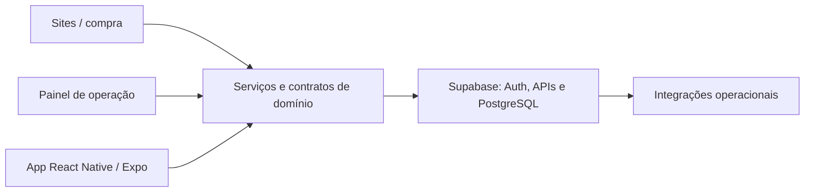

# Time Saving Restaurants

**Status:** em produção.
**Tipo:** Ecossistema web e mobile para restaurantes.

## Escopo

Plataforma que reúne experiência de compra, cardápio, pedidos e gestão da operação, com sites, painel e aplicativo mobile.

- Sites e experiência de compra para o cliente.
- Painel de gestão para a operação do restaurante.
- Aplicativo mobile e serviços compartilhados entre as superfícies.

## Stack

TypeScript, React, Next.js, React Native/Expo, Supabase/PostgreSQL e Cloudflare.

## Visão de arquitetura

Diagrama de alto nível das principais camadas e integrações.

## Pontos de engenharia

- Separação entre loja, gestão e aplicativo.
- Modelagem para diferentes estabelecimentos e perfis de acesso.
- Compartilhamento de contratos e serviços entre web e mobile.

## Conheça

[Plataforma — requer acesso](https://restaurants.timesavingtech.com.br)

O código da aplicação permanece em repositórios privados. Este estudo apresenta o escopo técnico e os pontos de arquitetura do produto.
